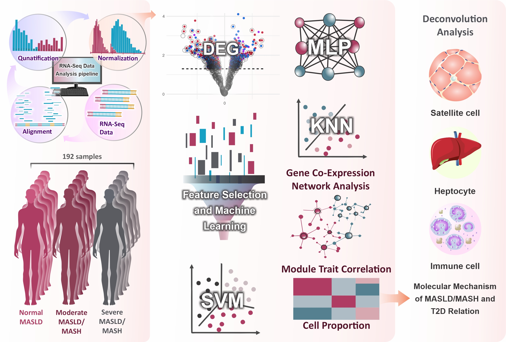

# MASLD/MASH progression association with T2D from computational perspective using Transcriptomics Data
This is the github repository of research article titeled "Computational analysis of hepatic transcriptomic data reveals potential mechanisms of MASLD progression and its association with type 2 diabetes"
## Graphical Abstract

## Abstract:
The relationship between metabolic disease and hepatic dysfunction is complex and multifactorial.  Here we sought to explore the molecular complexity underlying MASLD/MASH progression and its association with type 2 diabetes (T2D) using computational approaches and machine learning. We conducted a gene co-expression network analysis with WGCNA, identifying key gene modules related to MASLD/MASH and T2D. Notable modules included greenyellow, with significant genes such as LUM, LAMA2, and C7 linked to disease progression. Gene set enrichment analysis revealed that genes associated with MASLD/MASH and T2D are enriched in pathways related to focal adhesion and extracellular matrix interactions. Machine learning, employing mutual information gain for feature selection, identified an MLP classifier with ten features as the most accurate, achieving over 92% accuracy in distinguishing disease stages. Key findings include the roles of PLA2G2A and CYP7A1 in lipid metabolism, CHI3L1 and CCL20 in Fibrosis and inflammation, and MT-RNR2 in insulin sensitivity. This research provides insights into MASLD/MASH progression and its link with diabetes, highlighting potential biomarkers and therapeutic targets.

## Figures:
Figures of the article stored in **Figures** directory.

## Supplementary Files
Supplementary tables and figures stored in **Supplementary** folder.

## Contact me:
If you have any question regarding this research contact me from this email address:
**Email:** naser.elmi@ut.ac.ir
